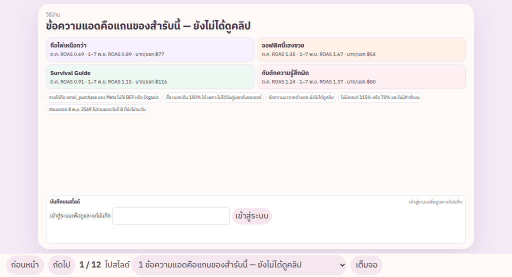
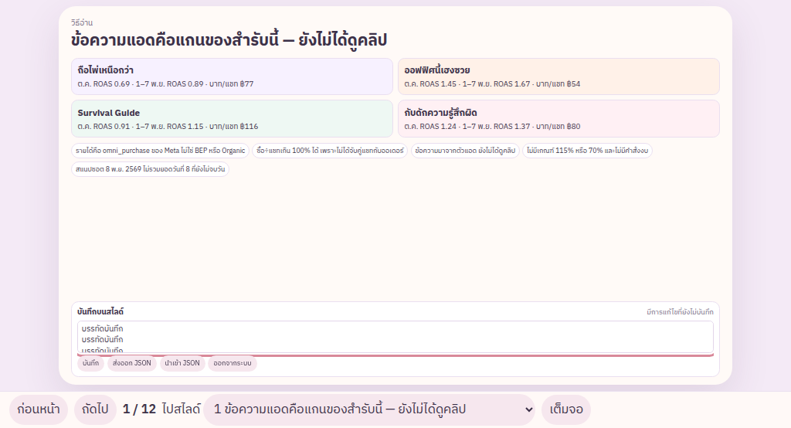
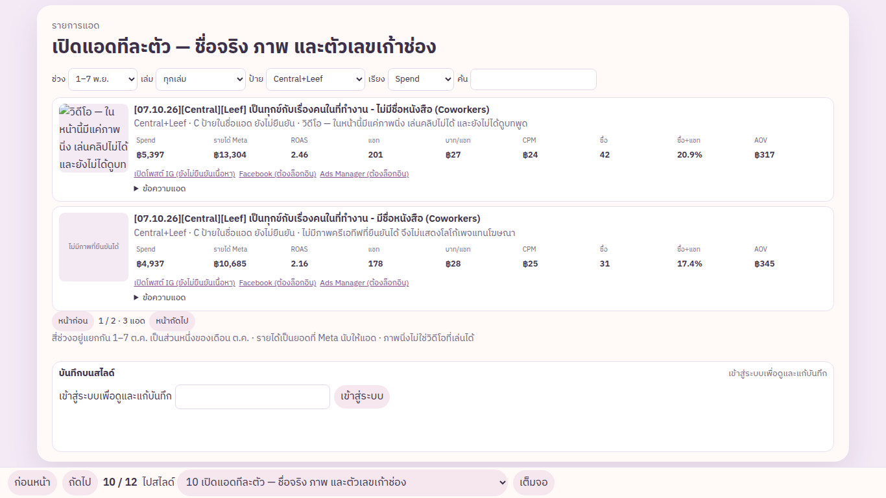
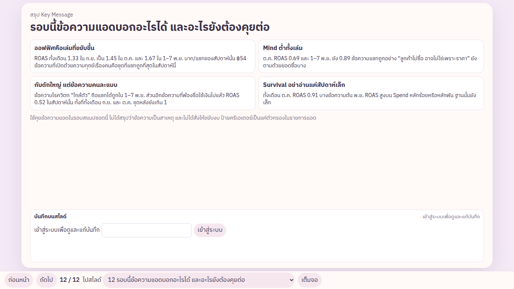

# ความคืบหน้า

สถานะจากของที่รันได้ในรีโปนี้ ไม่ใช่การประเมินเป็นเปอร์เซ็นต์

## ทำแล้วและมีผลทดสอบ

- [x] สำรับ 12 สไลด์ แกนเป็นข้อความแอด สไลด์ 12 สรุปสิ่งที่ข้อความบอกได้ ไม่ใช่อันดับครีเอเตอร์
- [x] บันทึกอยู่บนสไลด์ทุกหน้า คนที่ยังไม่เข้าสู่ระบบเห็นคำว่าเข้าสู่ระบบ ไม่เห็นข้อความ คนที่เข้าแล้วเห็นและแก้บนสไลด์ได้
- [x] บันทึกและบันทึกอัตโนมัติมีสถานะ กำลังบันทึก / บันทึกแล้ว / ยังไม่บันทึก / ชนกับฉบับใหม่
- [x] PostgreSQL: เซฟแล้วเปิดเซสชันใหม่ อ่านเจอ, ปิดแล้วเปิดเซิร์ฟเวอร์ใหม่ ข้อความยังอยู่, คนไม่มีคุกกี้ถูกปฏิเสธ, ส่ง revision เก่าได้ 409
- [x] จอ 1024×554 และ 1366×768 แถบล่างไม่ทับสไลด์ ลูกศรเดินครบ 12 หน้า พิมพ์ในช่องบันทึกแล้วลูกศรไม่เปลี่ยนสไลด์
- [x] รายการแอดมี Spend, รายได้ Meta, ROAS, แชท, บาท/แชท, CPM, ซื้อ, ซื้อ÷แชท, AOV กรองและเปลี่ยนหน้าได้ ป้าย Central แยกจาก Central+Leef, Central+Park, Central+Phum
- [x] ถ้า `app.js` โหลดไม่ขึ้น สไลด์แรกยังเห็น
- [x] ภาพที่ยืนยันแล้ว 83 ไฟล์ นามบัตร Kaoborkwa ไม่ถูกใช้เป็นครีเอทีฟ และตัด ad `120255364063130260` กับ `120255499941520260` ออกจากตัวเลข

คำสั่งที่ผ่านในเครื่องนี้: `npm test` (ตัวเลขอัตราจากผลรวม, คุกกี้, บันทึกข้ามการรีสตาร์ท, และเบราว์เซอร์)

## ภาพจากรอบทดสอบ

## ยังไม่มี

- [ ] ลิงก์สาธารณะที่เซฟบันทึกข้ามเครื่องได้จริง

รอบนี้ไม่ได้สมัครโฮสต์ใหม่ และไม่ได้ใช้ GitLab หรือฐานข้อมูลของบริษัท GitHub Pages โชว์สไลด์ได้อย่างเดียว บันทึกจะขึ้นว่ายังไม่ได้ตั้งค่า

ขั้นที่ต้องทำเองอยู่ใน `README.md`: สร้าง `.env` จากตัวอย่าง, รัน `npm run hash-password`, แล้ว `docker compose up --build` จากนั้นวาง HTTPS หน้าพอร์ต 8080 และตั้ง `TRUST_PROXY=1` บน HTTP ตรง ๆ ระบบจะไม่ยอมออกคุกกี้ Secure
